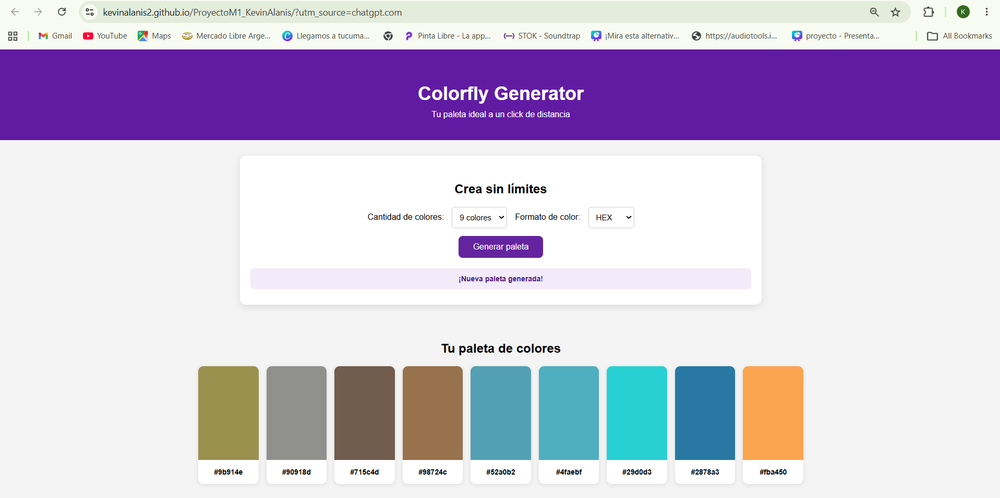

# 🎨 Colorfly Generator

Aplicación web interactiva para generar paletas de colores aleatorias, visualizar sus códigos y personalizar la cantidad y el formato de los colores.

**Proyecto Integrador 1 — Soy Henry**



🔗 **[Ver demo en vivo](https://kevinalanis2.github.io/ProyectoM1_KevinAlanis/)**

📁 **[Ver repositorio en GitHub](https://github.com/kevinalanis2/ProyectoM1_KevinAlanis)**

---

## 📋 Descripción

Colorfly Generator es una aplicación web estática que permite crear paletas de colores aleatorias de manera sencilla e interactiva.

El usuario puede elegir la cantidad de colores que desea generar y seleccionar el formato en el que quiere visualizar sus códigos: HEX, HSL o RGBA.

El proyecto fue desarrollado como parte del Proyecto Integrador 1 de Henry, aplicando conocimientos de HTML5, CSS3, JavaScript, manipulación del DOM y control de versiones con Git y GitHub.

---

## ✨ Funcionalidades

### Funcionalidades principales

- ✅ Generación aleatoria de paletas de colores.
- ✅ Selección de cantidad de colores: 6, 8 o 9.
- ✅ Visualización de códigos en formatos HEX, HSL y RGBA.
- ✅ Actualización del formato sin generar nuevos colores.
- ✅ Actualización automática de la cantidad de tarjetas al modificar el selector.
- ✅ Microfeedback visual al generar una nueva paleta.
- ✅ Diseño responsive para escritorio y dispositivos móviles.
- ✅ Estructura HTML semántica y controles con etiquetas asociadas.

---

## 🖥️ Manual de usuario

### ¿Cómo generar una paleta?

Presioná el botón **"Generar paleta"** para crear una nueva combinación aleatoria de colores.

### ¿Cómo cambiar la cantidad de colores?

En el selector **"Cantidad de colores"**, elegí entre 6, 8 o 9 colores.

Si ya existe una paleta, la cantidad de tarjetas se actualiza automáticamente. Si aumentás la cantidad, se agregan nuevos colores; si la reducís, se eliminan los sobrantes.

### ¿Cómo cambiar el formato de los colores?

En el selector **"Formato de color"**, elegí entre HEX, HSL o RGBA.

Los códigos de las tarjetas se actualizan automáticamente sin generar una nueva paleta ni modificar los colores existentes.

### ¿Cómo visualizar una nueva combinación?

Presioná nuevamente **"Generar paleta"**. La aplicación creará una nueva combinación aleatoria y mostrará un mensaje de confirmación.

---

## 🛠️ Decisiones técnicas

### Representación interna de los colores

Los colores se almacenan en un array llamado `coloresActuales`, utilizando objetos con sus componentes RGB (rojo, verde y azul).

Esta representación permite mantener los valores originales y convertirlos a distintos formatos sin perder información.

### Conversión de formatos

Se implementaron funciones independientes para convertir los valores RGB a los formatos disponibles:

- `convertirRGBaHEX()`
- `convertirRGBaHSL()`
- `convertirRGBaRGBA()`

La función `obtenerCodigoColor()` determina qué conversión utilizar según el formato seleccionado por el usuario.

### Manipulación dinámica del DOM

La función `mostrarPaleta()` crea las tarjetas de colores dinámicamente mediante JavaScript, utilizando `document.createElement()` y agregando los elementos a la galería.

Esto permite actualizar la visualización sin modificar directamente el HTML.

### Conservación y actualización de la paleta

Se utiliza el array `coloresActuales` para conservar los colores generados.

Al cambiar el formato, se actualiza únicamente el código mostrado. Al modificar la cantidad, se agregan o eliminan elementos del array según corresponda, conservando los colores existentes siempre que sea posible.

### Diseño responsive

Se utilizaron Flexbox, CSS Grid y media queries para adaptar la interfaz a distintos tamaños de pantalla.

En escritorio, la galería utiliza Flexbox. En dispositivos con un ancho de hasta 768px, se organiza mediante CSS Grid en tres columnas.

### Accesibilidad

Se incorporaron etiquetas HTML semánticas, `label` asociados a los selectores y el atributo `aria-live="polite"` en el mensaje de feedback para comunicar las actualizaciones dinámicas.

---

## 🚀 Cómo ejecutar el proyecto en local

El proyecto no requiere instalación de dependencias ni herramientas adicionales para funcionar.

1. Cloná el repositorio:

```bash
git clone https://github.com/kevinalanis2/ProyectoM1_KevinAlanis.git
```

2. Ingresá a la carpeta del proyecto:

```bash
cd ProyectoM1_KevinAlanis
```

3. Ingresá a la carpeta `Desarrollo`:

```bash
cd Desarrollo
```

4. Abrí el archivo `index.html` en tu navegador.

También podés utilizar la extensión **Live Server** de Visual Studio Code para visualizar los cambios durante el desarrollo.

---

## 🌐 Publicación en GitHub Pages

La aplicación está publicada mediante **GitHub Pages y GitHub Actions**.

El proyecto cuenta con un flujo de trabajo automatizado ubicado en:

`.github/workflows/deploy.yml`

Cada vez que se realiza un `push` a la rama `main`, GitHub Actions prepara los archivos de la carpeta `Desarrollo` y ejecuta el despliegue de la aplicación.

**Demo publicada:**

https://kevinalanis2.github.io/ProyectoM1_KevinAlanis/

---

## 🗂️ Estructura del proyecto

```text
ProyectoM1_KevinAlanis/
│
├── .github/
│   └── workflows/
│       └── deploy.yml
│
├── Desarrollo/
│   ├── index.html
│   ├── css/
│   │   └── styles.css
│   └── JavaScript/
│       └── script.js
│
├── Documentacion/
│   ├── capturas/
│   └── uso de IA/
│       └── README.md
│
└── README.md
```

---

## 🧰 Tecnologías utilizadas


---

## 🤖 Documentación del uso de IA

Durante el desarrollo se utilizaron herramientas de inteligencia artificial como apoyo para resolver errores, mejorar funcionalidades y consultar alternativas de implementación.

Los prompts, resultados y reflexiones sobre su utilización se encuentran documentados en:

`Documentacion/uso de IA/README.md`

---

## 👨‍💻 Autor

**Kevin Alanis**

Proyecto Integrador 1 — Soy Henry.